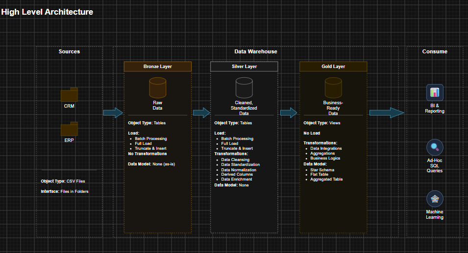
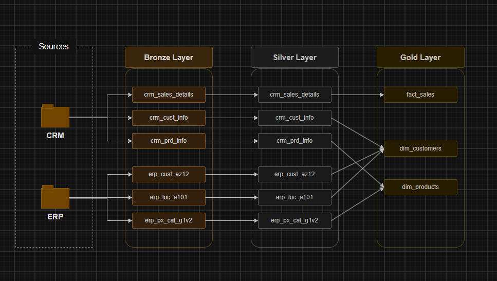
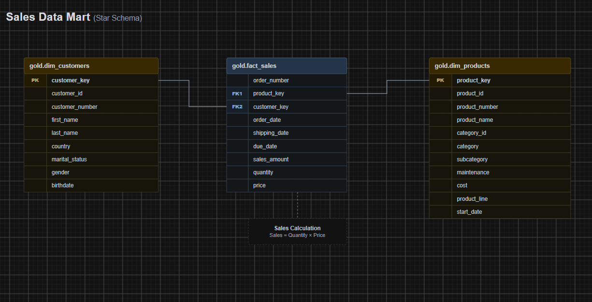

# 🏢 SQL Data Warehouse Project

An end-to-end data warehouse built with **SQL**, using the **Medallion Architecture (Bronze → Silver → Gold)**. The project consolidates data from two source systems (**CRM** and **ERP**) into a clean, business-ready **Star Schema** for analytics and reporting.
> 💡 Inspired by the Data with Baraa SQL Data Warehouse course.

---

## 📌 Project Overview

This project covers the full data engineering workflow:

- **Data Architecture:** designing a modern warehouse with Bronze, Silver, and Gold layers
- **ETL Pipelines:** extracting, transforming, and loading data from CSV sources
- **Data Modeling:** building fact and dimension tables in a Star Schema
- **Analytics Ready:** the final model serves BI, reporting, ad-hoc SQL, and ML use cases
- 

---

## 🏗️ Data Architecture



| Layer | Object Type | Load Strategy | Transformations | Data Model |
|-------|-------------|---------------|-----------------|------------|
| 🥉 **Bronze** | Tables | Batch processing, Full load, Truncate & Insert | None (raw, as-is) | None |
| 🥈 **Silver** | Tables | Batch processing, Full load, Truncate & Insert | Cleansing, Standardization, Normalization, Derived columns, Enrichment | None |
| 🥇 **Gold** | Views | No load (views over Silver) | Data integration, Aggregations, Business logic | Star Schema, Flat tables, Aggregated tables |

### Sources

| System | Format | Interface |
|--------|--------|-----------|
| **CRM** | CSV files | Files in folders |
| **ERP** | CSV files | Files in folders |

---

## 🔄 Data Flow



| Bronze | Silver | Gold |
|--------|--------|------|
| `crm_sales_details` | `crm_sales_details` | `fact_sales` |
| `crm_cust_info` | `crm_cust_info` | `dim_customers` |
| `crm_prd_info` | `crm_prd_info` | `dim_products` |
| `erp_cust_az12` | `erp_cust_az12` | |
| `erp_loc_a101` | `erp_loc_a101` | |
| `erp_px_cat_g1v2` | `erp_px_cat_g1v2` | |

---

## ⭐ Data Model (Gold Layer)



### `gold.fact_sales`
Transactional sales data. **Sales = Quantity × Price**

| Column | Description |
|--------|-------------|
| `order_number` | Unique order identifier |
| `product_key` | FK → `dim_products` |
| `customer_key` | FK → `dim_customers` |
| `order_date` | Date the order was placed |
| `shipping_date` | Date the order was shipped |
| `due_date` | Payment due date |
| `sales_amount` | Total sales value |
| `quantity` | Units sold |
| `price` | Unit price |

### `gold.dim_customers`
Customer details integrated from CRM and ERP.

`customer_key` (PK), `customer_id`, `customer_number`, `first_name`, `last_name`, `country`, `marital_status`, `gender`, `birthdate`

### `gold.dim_products`
Product details and categories integrated from CRM and ERP.

`product_key` (PK), `product_id`, `product_number`, `product_name`, `category_id`, `category`, `subcategory`, `maintenance`, `cost`, `product_line`, `start_date`

---

## 🔧 Key Transformations (Silver Layer)

- Removing duplicates and handling nulls
- Trimming unwanted spaces
- Standardizing values (e.g., gender, marital status, country codes)
- Fixing invalid dates and inconsistent formats
- Recalculating sales/price when values are missing or incorrect
- Deriving new columns and enriching data across sources

---

## 📁 Repository Structure

```
sql-data-warehouse-project/
│
├── datasets/              # Raw CSV files (CRM & ERP)
├── docs/                  # Architecture, data flow, and data model diagrams
├── scripts/
│   ├── bronze/            # Create tables & load raw data
│   ├── silver/            # Cleansing & transformation scripts
│   └── gold/              # Views for the star schema
├── tests/                 # Data quality checks
└── README.md
```

> Update this tree to match your actual folder names.

---

## 🚀 Getting Started

### Prerequisites
- SQL Server (Express or Developer edition)
- SQL Server Management Studio (SSMS) or Azure Data Studio
- Git

### Setup

1. **Clone the repository**
   ```bash
   git clone https://github.com/youssefWaled12/sql-data-warehouse-project.git
   ```
2. **Create the database and schemas** (`bronze`, `silver`, `gold`)
3. **Update file paths** in the Bronze load script to point to your local `datasets/` folder
4. **Run the scripts in order:**
   1. Bronze: create tables and load raw data
   2. Silver: clean and transform the data
   3. Gold: create the star schema views
5. **Query the Gold layer**
   ```sql
   SELECT TOP 10 *
   FROM gold.fact_sales;
   ```

---

## 📊 Use Cases

The Gold layer is ready to power:

- **BI & Reporting** (Power BI, Tableau)
- **Ad-hoc SQL queries**
- **Machine Learning** feature preparation

Example questions it can answer:
- Who are the top customers by revenue?
- Which product categories and subcategories perform best?
- How do sales trend over time and by country?

---

## 🛠️ Tech Stack

`SQL` · `SQL Server` · `T-SQL` · `ETL` · `Data Modeling` · `Medallion Architecture` · `Star Schema`

---

## 👤 Author

**Youssef Waled**

- GitHub: [@youssefWaled12](https://github.com/youssefWaled12)
- LinkedIn: www.linkedin.com/in/youssef-waled-bb6888366

---

## 📝 License

This project is licensed under the MIT License. Feel free to use and adapt it.
